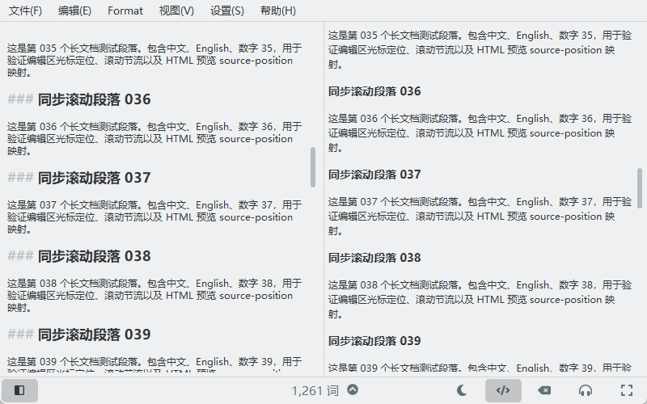

<div align="center">
  
  <h1>YumiMDWriter</h1>
  <p>A Windows-focused Markdown editor based on KDE ghostwriter.</p>
</div>

YumiMDWriter 是基于 [KDE ghostwriter](https://github.com/KDE/ghostwriter) 的中文增强版 Markdown 编辑器。项目保留上游编辑器、渲染管线、作者信息与 GPL 许可证，在 Windows 上增加中文输入、预览同步、本地图片和系统字体相关改进。

> 本仓库是社区维护的衍生项目，并非 KDE 官方发行版。

## 主要改进

- Windows 中文输入法候选框跟随真实文本光标，兼容滚动、窗口移动和 DPI 变化。
- 编辑器滚动时，以左侧最上方实际可见文字行为锚点，将右侧对应 HTML 块定位到顶部。
- 光标移动时按照光标在编辑器视口中的相对位置同步预览。
- cmark-gfm 预览节点包含 `data-sourcepos`，导出的正式 HTML 不包含内部同步属性。
- 支持相对路径、中文路径、空格路径和 `file:///` 本地图片。
- 支持拖入文件打开、拖入图片插入 Markdown、从剪贴板保存并插入图片。
- 图片加载失败时显示非阻塞占位信息。
- Windows 默认使用系统常规字体与等宽字体。
- Windows 程序名、窗口、关于页和文件元数据统一为 `YumiMDWriter`。



## 源码构建

最低要求：

- CMake 3.16+
- C++20 编译器
- Qt 6.5+
- KDE Frameworks 6.0+
- Extra CMake Modules 6.0+
- Ninja（推荐）

Windows 推荐使用 Visual Studio 2022 x64 与 KDE Craft。完整步骤见 [BUILDING_WINDOWS.md](BUILDING_WINDOWS.md)。进入已经加载 MSVC 与 Craft 环境的 PowerShell 后，可以运行：

```powershell
.\scripts\build-windows.ps1 -CraftRoot C:\CraftRoot
```

通用 CMake 构建：

```text
cmake -S . -B build -G Ninja -DCMAKE_BUILD_TYPE=Release -DBUILD_TESTING=ON
cmake --build build
ctest --test-dir build --output-on-failure
```

Windows 输出文件为 `build/bin/YumiMDWriter.exe`。Linux 与 macOS 继续使用上游的 `ghostwriter` 目标名称与桌面元数据。

## 仓库说明

- [CUSTOM_CHANGES.md](CUSTOM_CHANGES.md)：与上游相比的功能修改。
- [BUILDING_WINDOWS.md](BUILDING_WINDOWS.md)：Windows 构建与部署说明。
- [UPSTREAM.md](UPSTREAM.md)：上游来源和同步策略。
- [RELEASE_CHECKLIST.md](RELEASE_CHECKLIST.md)：发布前检查清单。
- [CONTRIBUTING_YUMIMDWRITER.md](CONTRIBUTING_YUMIMDWRITER.md)：贡献指南。
- `autotest/`：Qt 自动化测试。
- `LICENSES/`、`COPYING`、`.reuse/dep5`：许可证与第三方归属。

## 发布二进制

仓库本身只存放源码。便携版应通过 GitHub Releases 发布，并包含 Qt、KDE Frameworks、WebEngine、图像插件、许可证和对应版本源码。不要把本机 CraftRoot、构建缓存或未使用的 SDK 提交到仓库。

## 上游与许可证

YumiMDWriter 基于 KDE ghostwriter 26.11.70。上游项目版权归原作者及 KDE 贡献者所有。

主程序遵循 [GPL-3.0-or-later](LICENSES/GPL-3.0-or-later.txt)。第三方组件和部分资源使用兼容许可证，详情见 [COPYING](COPYING)、[resources/COPYING](resources/COPYING) 和各第三方目录。自定义图标由 YumiMDWriter 项目贡献者以 GPL-3.0-or-later 提供；发布者应确保自己有权以该许可证分发此资源。

## English

YumiMDWriter is a Windows-focused fork of KDE ghostwriter with improved Chinese IME positioning, source-aware preview synchronization, local-image workflows, drag and drop, Windows system fonts, and custom Windows branding. See [BUILDING_WINDOWS.md](BUILDING_WINDOWS.md) for a reproducible Qt 6/KF6 build.
